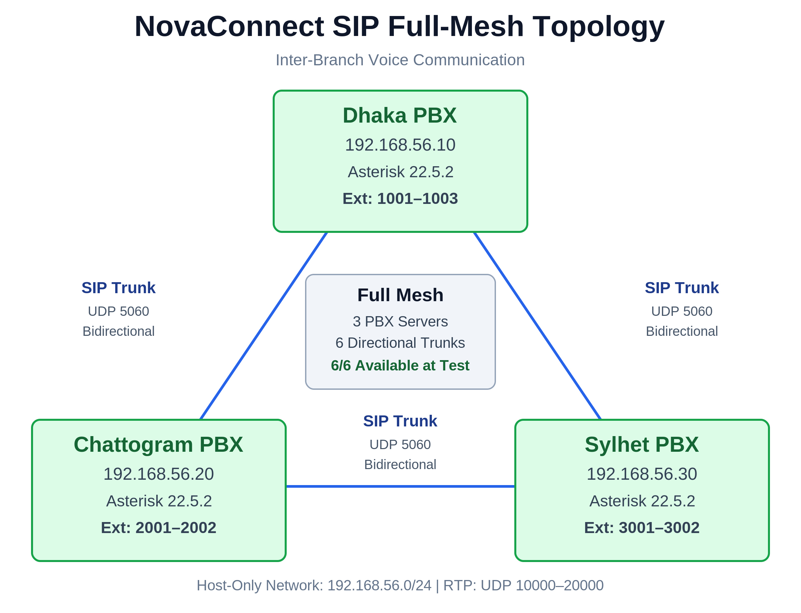

# NovaConnect Enterprise VoIP Infrastructure

A hands-on, multi-branch enterprise telephony lab built with Asterisk, Ubuntu Server and Oracle VirtualBox. The project simulates three interconnected offices in Dhaka, Chattogram and Sylhet, with SIP-based voice communication, call services, network security, VLAN segmentation and Linux traffic prioritization.

> **Scope:** This is an isolated virtualized engineering lab, not a live IPTSP or production WAN deployment.

## Architecture




Three Asterisk PBX instances communicate over a shared VirtualBox host-only network (192.168.56.0/24). Each PBX has two directional peer trunks, forming three bidirectional logical relationships. A separate VirtualBox internal network demonstrates IEEE 802.1Q VLAN segmentation.

| Branch | Hostname | PBX IP | Configured SIP endpoints | VLAN | VLAN IP |
|---|---|---|---|---|---|
| Dhaka | dhaka-pbx-01 | 192.168.56.10/24 | 1001–1003 | 10 | 10.10.10.10/24 |
| Chattogram | ctg-pbx-01 | 192.168.56.20/24 | 2001–2002 | 20 | 10.10.20.20/24 |
| Sylhet | sylhet-pbx-01 | 192.168.56.30/24 | 3001–3002 | 30 | 10.10.30.30/24 |

Endpoint 1003 is an additional test endpoint; it is not included in the exported incoming call routes.

## Implemented Features

- **IP PBX:** Three Ubuntu Server VMs running Asterisk 22.5.2, with PJSIP endpoints and MicroSIP/Linphone clients.
- **Call services:** Local and inter-branch dialing, custom IVR (2000), voicemail access (3000), and busy-call forwarding at Dhaka.
- **SIP trunking:** IP-identified peer trunks, explicit incoming routing contexts, and periodic SIP qualification.
- **Call reporting:** CSV Call Detail Records (CDR) and a Python reporting script for recent records and disposition summaries.
- **Security:** UFW inbound filtering, SSH restricted to the host, Fail2Ban SSH/Asterisk jails and disabled unused IAX2 module.
- **VLAN lab:** Persistent tagged interfaces for VLANs 10, 20 and 30, with same-VLAN connectivity and cross-VLAN isolation tests.
- **QoS:** CS3 SIP signaling and EF RTP audio marking, Linux `tc` priority queues and a systemd service for reboot persistence.
- **Recovery:** Configuration backups and final snapshots of all three VMs.

## Technology Stack

| Area | Tools and protocols |
|---|---|
| Virtualization | Oracle VirtualBox |
| Operating system | Ubuntu Server |
| Telephony | Asterisk 22.5.2, PJSIP, SIP, RTP, G.711 |
| Softphones | MicroSIP, Linphone |
| Networking | IPv4, Netplan, IEEE 802.1Q, ICMP |
| Security | UFW, Fail2Ban, SSH |
| QoS and diagnostics | Linux tc, DSCP, tcpdump, iperf3 |
| Automation and reporting | Bash, systemd, Python, CSV |
| Documentation | Network diagrams, Word reports, GitHub |

## Network and Security Policy

| Traffic | Protocol / port | Policy |
|---|---|---|
| SIP signaling | UDP 5060 | Host-only subnet; CS3 (DSCP 24) |
| RTP audio | UDP 10000–20000 | Host-only subnet; EF (DSCP 46) |
| SSH administration | TCP 22 | Windows host 192.168.56.1 only |
| Other unsolicited inbound traffic | — | Denied by default |

The QoS classifier prioritizes EF audio first, CS3 signaling second and best-effort traffic third on `enp0s8`. The VLAN demonstration uses a separate adapter (`enp0s9`); SIP/RTP traffic is not carried over those VLANs.

## Testing and Results

| Metric | Lab result |
|---|---|
| Final ICMP connectivity | 24/24 successful probes |
| Mean ICMP round-trip time | 4.072 ms |
| ICMP packet loss | 0% in final sample |
| SIP peer contacts | 6/6 available |
| Final local and inter-branch voice test cases | 9/9 passed (operator-confirmed) |
| IVR and voicemail regression cases | 7/7 passed (operator-confirmed) |
| Essential service checks | 12/12 active |
| Failed system units | 0 across three VMs |
| Baseline TCP throughput | 719 Mbps receiver |
| Baseline UDP test | 5 Mbps, 0/4317 datagrams lost |

### Congestion and QoS Demonstration

A temporary 2 Mbps egress bottleneck on Dhaka was stressed using a 5 Mbps UDP background stream toward Chattogram while a voice call was active.

| Observation | Without priority classification | With priority classification |
|---|---|---|
| Background UDP receiver throughput | 1.94 Mbps | 1.91 Mbps |
| Background UDP datagram loss | 61% | 62% |
| Subjective voice observation | Slight delay | Clear voice |
| EF / CS3 queue drops | Not separately measured | 0 / 0 |
| Best-effort child queue drops | Not separately measured | 15,977 |

The priority-enabled trial demonstrates local queue protection for marked traffic under congestion. It does not establish zero end-to-end RTP loss, improved measured voice latency, or production-grade voice quality. Background UDP statistics are not RTP statistics. The queue configurations differed between trials. The temporary bottleneck was removed after testing.

## Repository Structure

```text
NovaConnect-Enterprise-VoIP/
├── audio/                 # Custom IVR welcome prompt
├── configs/
│   ├── dhaka/             # Sanitized PBX, dialplan and network settings
│   ├── chattogram/
│   └── sylhet/
├── diagrams/              # Enterprise architecture and SIP topology
├── docs/                  # Technical project report
├── reports/               # Testing and performance report
├── screenshots/           # Optional reviewed test evidence
├── scripts/
│   ├── cdr_report.py
│   ├── novaconnect-qos.sh
│   └── novaconnect-qos.service
└── README.md
```

## Documentation

- [Technical Project Report](docs/NovaConnect-Technical-Project-Report.docx)
- [Testing and Performance Report](reports/NovaConnect-Testing-Performance-Report.docx)
- [Enterprise Architecture](diagrams/01-NovaConnect-Enterprise-Architecture.jpg)
- [SIP Full-Mesh Topology](diagrams/02-NovaConnect-SIP-Full-Mesh.jpg)

## Reproducing the Lab

1. Create three Ubuntu Server VMs with NAT, host-only and separate internal-network adapters. Use unique adapter MAC addresses and appropriate interface names for the new environment.
2. Install Asterisk and the required security and diagnostic tools.
3. Review the branch-specific files under `configs/` and merge the relevant settings into the local Asterisk, Netplan and Fail2Ban configuration. These are sanitized documentation templates, not complete drop-in deployment backups.
4. Replace credential placeholders with strong, unique SIP passwords and numeric voicemail PINs. Adjust interface names and MAC matching before applying Netplan changes.
5. Configure the firewall rules, voicemail module, CDR logging and CSV backend. Install `audio/welcome.wav` under the active Asterisk sounds directory as `custom/welcome.wav`.
6. Review `scripts/novaconnect-qos.sh` before applying it; it replaces the root egress queue on its configured interface. Install the systemd service and verify queue classification after reboot.
7. Register softphones and validate local calls, peer trunks, inter-branch calls, IVR and voicemail. Run the CDR reporting script against the local CSV log.

## Limitations and Future Work

- All three sites are simulated on one physical host; measured latency and throughput are not real inter-city WAN results.
- SIP trunks use IP identification without trunk authentication in an isolated lab. Production deployments require stronger authentication, TLS/SRTP where appropriate, tighter access controls and additional perimeter protections.
- The exported Dhaka IVR dialplan has no explicit invalid-input handler, although the operator reported a successful invalid-input test.
- CDR counts represent records, not necessarily unique calls. Cloned VMs may retain historical records.
- No carrier/PSTN interconnection, high availability, independent load-capacity test or objective end-to-end MOS measurement was implemented.
- Future work: authenticated encrypted trunks, routed voice VLANs, controlled WAN emulation, RTP-level quality monitoring, centralized reporting and automated provisioning.

## Skills Demonstrated

Linux server administration · Asterisk/PJSIP configuration · SIP/RTP troubleshooting · IPv4 network planning · VLAN segmentation · Firewall policy · Fail2Ban · DSCP and Linux traffic control · Bash/systemd automation · Python reporting · Technical testing and documentation

---

Built as a practical networking and VoIP engineering portfolio project.
